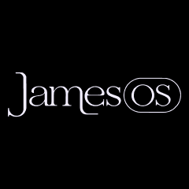
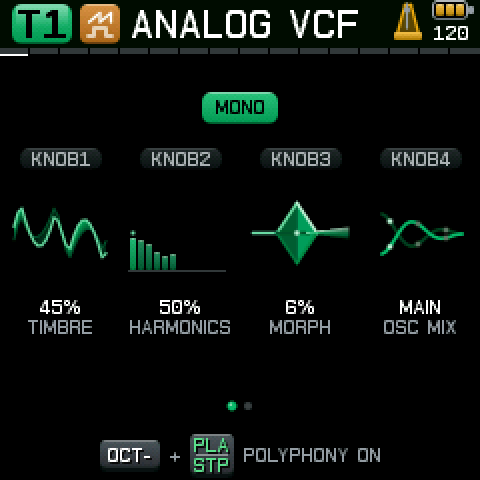
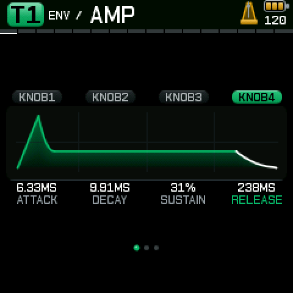
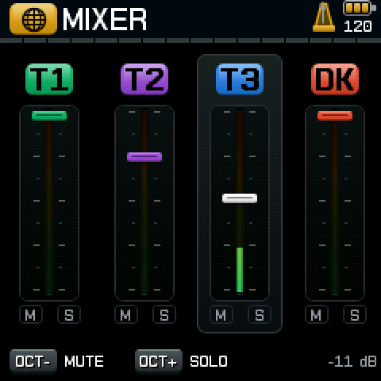
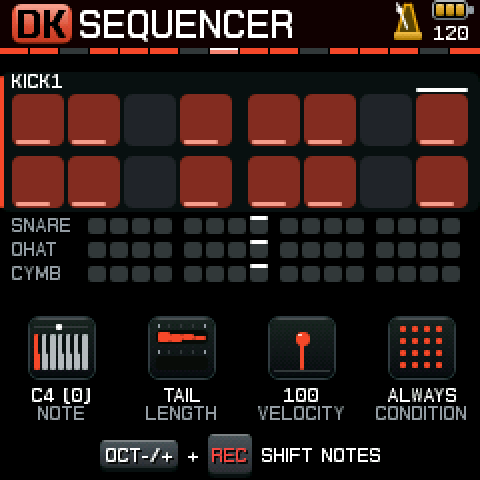
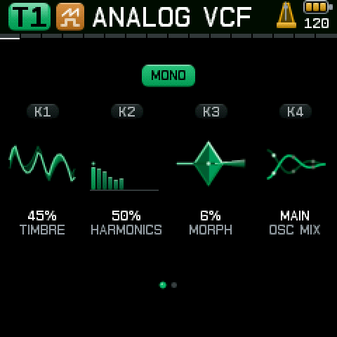
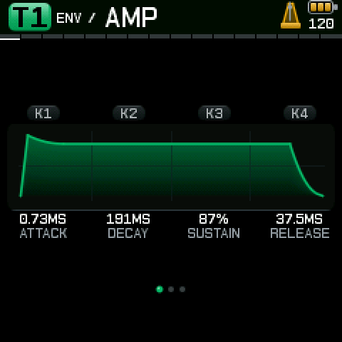
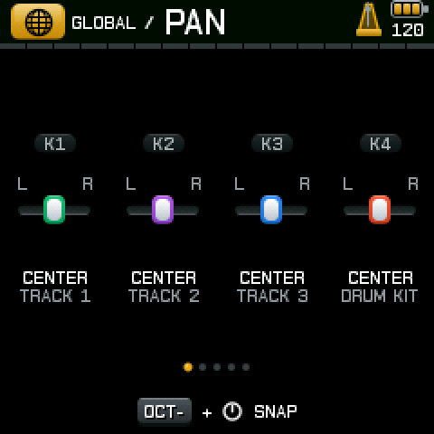

# JamesOS

  

JamesOS is independent, open-source firmware for the **M-VAVE FM-1**. It combines three synth tracks, a four-lane drum kit, a sequencer and a song arranger in one instrument. **JamesOS-K** brings the same sounds and workflow to the **M-VAVE SMK-37 Pro**.

A [Gjelly](https://gjelly.com/JamesOS) project by Aaron Grando, a.k.a. James Os.

**[Install or update](https://gjelly.com/JamesOS/install)** · **[FM-1 manual](https://gjelly.com/JamesOS/manual)** · **[SMK-37 Pro manual](https://gjelly.com/JamesOS/manual-k)** · **[Project Editor](https://gjelly.com/editor)**

## Current release

**1.0b · Build 3124 · November 21, 2026**

| Product | Device | Firmware identity |
| --- | --- | --- |
| JamesOS | M-VAVE FM-1 | `FM-1_9673124` |
| JamesOS-K | M-VAVE SMK-37 Pro | `SMK-37 Pro_9653124` |

Both products share this source tree. Each has its own firmware package and control layout. The browser Project Editor currently supports the FM-1 only.

[Release notes](docs/RELEASE-1.0b.md) · [Firmware and source downloads](https://github.com/aarongrando/JamesOS/releases/tag/v1.0b-build-3124)

## Interface screenshots

Screens rendered from the released **1.0b, build 3124** source for each device.

### JamesOS · FM-1

<table>
  <tr>
    <td align="center"> Sound controls</td>
    <td align="center"> Amplitude envelope</td>
  </tr>
  <tr>
    <td align="center"> Track mixer</td>
    <td align="center"> Drum sequencer</td>
  </tr>
</table>

### JamesOS-K · SMK-37 Pro

<table>
  <tr>
    <td align="center"> Sound controls</td>
    <td align="center"> Amplitude envelope</td>
  </tr>
  <tr>
    <td align="center"> Stereo panning</td>
    <td align="center"> Step editing with the keyboard</td>
  </tr>
</table>

## Make sounds, patterns and songs

- **Synthesis:** 24 Plaits engines, 128 starting sounds, three synth tracks and a four-lane kit made with Plaits percussion.
- **Sequencing:** patterns up to 64 steps, an arpeggiator, drum retrigger and a song arranger with up to 64 blocks.
- **Polyphonic play:** play chords on a selected synth track while the sequencer is stopped. Voice count depends on the engine; starting playback returns to multitrack sequencing.
- **Sound shaping:** track filters, envelopes, glide, two modulation patch slots per track, track LFOs and a global LFO.
- **Effects and mixing:** drive, delay and modulation per track, shared reverb with individual sends, and master mix controls. Delay and reverb pre-delay can follow the tempo.
- **Projects:** 12 named save slots, with file import, export and older-project conversion through the FM-1 Editor.
- **Interface:** an HD display with control graphics, filter and envelope curves, and screen-reader support over USB MIDI.

## What's new in build 3124

Chords with Polyphony enabled are fuller and louder, with clean peaks. Long releases play out fully, including on the FM BANK engines, and Polyphony can engage while a previous release is still sounding.

The ARP page now shows an **ARP: ON** badge. On JamesOS-K, **KNOB BANK** returns to HOME from every page and menu. Hold a synth step pad and play a key to set that step's note.

See the [release notes](docs/RELEASE-1.0b.md) for details.

## Install or update

1. Back up the projects you want to keep.
2. Open the [installer](https://gjelly.com/JamesOS/install) in Chrome or Edge on a desktop computer.
3. Connect your instrument with a USB data cable and follow the installer.
4. Keep it powered and connected until the update finishes and the instrument restarts.

Use the package selected for your device and its installed firmware. FM-1 and SMK-37 Pro packages are not interchangeable. Changing firmware can overwrite saved data; an interrupted update can leave the instrument unresponsive.

### Existing projects

Build 3124 updates 1.0b builds 3110, 3120, 3122 and 3123 while preserving projects, sounds and settings.

Projects saved with **1.0a** need conversion in the [Editor](https://gjelly.com/editor). Download and keep the original, convert it, then import the result into an empty slot and listen to it. Conversion can change the sound or refuse incompatible data. Do not overwrite a slot marked **OLD FORMAT** before preserving its contents. Projects saved by 1.0b cannot be opened by 1.0a.

## Accessibility

The [FM-1 Screen Reader](https://charlesvestal.github.io/fm1-reader/) reads page names, selected items, control values and messages over USB MIDI. Open it in Chrome or Edge and choose **Connect**.

## Known issues

- When an external master starts clock and playback together, JamesOS can join two to three beats late.
- Tracks with different step rates can drift at some tempos.
- Drum retrigger repeats can land up to 4.9 ms early.

To [report a problem](https://github.com/aarongrando/JamesOS/issues), include your device, firmware build, steps to reproduce it and what happened.

## Build from source

See [Build instructions](docs/BUILD.md) for the build-3124 distribution commands and host tests. Device builds require the JieLi Linux toolchain and the pinned AC79 SDK; macOS builds use Docker.

| Directory | Contents |
| --- | --- |
| `firmware/` | Application, loader, hardware support and synthesis libraries |
| `assets/` | Inputs for generated firmware data |
| `tools/` | Build and device utilities |
| `tests/` | Host regression tests and comparison fixtures |
| `docs/` | Current release instructions and component notices |

## Licence and credits

JamesOS firmware is **GPL-3.0-only**; see [LICENSE](LICENSE). Third-party components retain their own terms, listed in [Third-party notices](docs/legal/THIRD-PARTY-NOTICES.md).

Built on [Dinghy](https://github.com/zvenson/dinghy) by zvenson and [Felucca](https://github.com/hugelton/Felucca) by Leo Kuroshita and Hügelton Instruments, with [SLOOP](https://github.com/isod89/sloop-fm1) contributions. Plaits, Braids and stmlib are by Emilie Gillet and retain their MIT licences. JamesOS-K's SMK-37 Pro input and display support derive from M. Geisler's Felucca SMK-37 port. The HD interface uses Chakra Petch under the SIL Open Font License; see the [font notice](docs/legal/HD-FONT-NOTICE.md).

JamesOS and JamesOS-K are independent community projects, unaffiliated with M-VAVE or Mutable Instruments.
